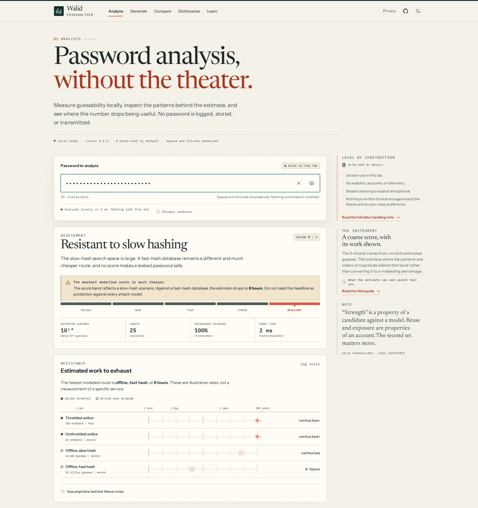

# Walid PassAnalyzer

A local-first password instrument. It measures guessability, explains the patterns behind the estimate, generates auditable randomness, compares candidates without exposing them, and checks breach exposure only when you explicitly ask.

The application is a static React/TypeScript site. There is no backend, account system, analytics script, or runtime CDN. All analysis and generation happen in the browser.

**Design direction:** Signal & Ink. A warm paper canvas, deep petrol surfaces, a vermilion signal accent, editorial typography, and measurement-oriented data displays. The visual system is original to this project and is implemented with semantic CSS tokens rather than a component framework.



## What it does

### Analysis

- Pattern-aware strength estimation with [zxcvbn](https://github.com/dropbox/zxcvbn), presented as a qualitative band and estimated orders of magnitude instead of a misleading 20-100% score.
- Explanation of the model's own sequence: dictionary terms, keyboard walks, repeats, sequences, dates, regex-like formats, and brute-force runs. Candidate tokens are not rendered or retained in the result object.
- Attack-model comparison for throttled online attempts, unthrottled online attempts, slow hashes, and fast hashes, with an expandable assumptions section.
- Whitespace-only values are assessed rather than silently cleared. Unicode and spaces are preserved exactly.
- Optional organization dictionary matching. Imported terms are held in memory for the tab only, matched with an Aho-Corasick automaton, and fed back to zxcvbn for re-estimation. Matched words are withheld from the UI and reports.
- Optional Pwned Passwords check using the k-anonymity range protocol. It is never automatic.

### Generation

- Random passwords with presets for recommended, maximum-compatibility, and high-security configurations.
- Character classes, length, ambiguous/look-alike exclusions, extra characters, exclusions, and optional space in the pool.
- Exact constrained search-space calculation and uniform sampling via dynamic programming, so the output always satisfies the selected class guarantees. No retry loop and no silent constraint failure.
- Passphrases from the complete official EFF Large (7,776 words) and EFF Short (1,296 words) lists. Word count, separator, capitalization, and an optional two-digit suffix are configurable.
- Generation entropy is reported separately from human-chosen guessability and explained with the actual selection space.
- If `crypto.getRandomValues` is unavailable, generation fails closed with a useful error. There is no `Math.random` fallback.

### Comparison

- Up to six candidates, ranked by zxcvbn's estimated guesses (not a character-class formula).
- Anonymized labels in results. Candidate text is never rendered in the ranking, copied, or exported.
- Relative orders of magnitude, score bands, fastest modelled attack, pattern summaries, duplicate detection, and an explanation of what differs.
- Clear limitations and a warning against entering several live account passwords.

### Dictionaries

- JSON array, named JSON object, or newline-separated TXT import.
- File and pasted-list paths, explicit validation, size and word limits, duplicate removal, control-character rejection, and session-only storage.
- Built-in EFF passphrase word lists and their source/license links.

### Reports

- PDF and text reports generated locally.
- The report API does not accept the candidate. Reports contain the assessment, attack estimates, pattern descriptions, recommendations, breach status, and method limits, but no password, candidate fragment, or imported dictionary word.
- Generic date-based filenames and safe PDF metadata.

### Education and transparency

- A field guide aligned with current NIST SP 800-63B and OWASP guidance: length, uniqueness, breach screening, password managers, MFA, passkeys, meter limits, and verifier policies.
- A privacy page that describes the actual implementation, including what k-anonymity does not hide and what JavaScript cannot guarantee.

## Privacy model

| Action                              | What leaves the browser                                                                                                                                                              |
| ----------------------------------- | ------------------------------------------------------------------------------------------------------------------------------------------------------------------------------------ |
| Default analysis                    | Nothing. The model runs in the tab.                                                                                                                                                  |
| Optional Pwned Passwords check      | The first five SHA-1 hex characters, `Add-Padding: true`, and ordinary request metadata such as IP address and user agent. The password and complete digest never leave the browser. |
| Clicking a reference or GitHub link | A normal request to that destination, only because you chose to follow the link.                                                                                                     |
| Loading the static site             | GitHub Pages receives ordinary hosting request metadata. There is no application analytics or telemetry.                                                                             |

Only two preferences can be stored in `localStorage`:

- `pa.theme`: `light` or `dark`.
- `pa.autoClear`: whether the five-minute inactivity clear is enabled.

No candidate, score, dictionary content, or report data is stored in `localStorage`, `sessionStorage`, IndexedDB, URLs, or a service worker cache. Imported dictionaries disappear when the tab is reloaded.

The breach check is opt-in. k-anonymity reduces disclosure but is not zero information: the service still sees the five-character prefix, your IP address, and request timing. The in-app privacy note says this explicitly.

The application cannot guarantee that JavaScript erases every copy of a secret from memory. React state, browser internals, extensions, operating-system input methods, and crash dumps are outside its control. Clearing a field removes the value from this component's state; it is not a cryptographic memory wipe.

## Security engineering

- **CSPRNG only.** `crypto.getRandomValues` is required for every generated password and passphrase. Missing support throws a specific error.
- **Unbiased selection.** Random words are mapped with rejection sampling; the modulo tail is discarded. Passphrase word selection and all case/number decisions use the same primitive.
- **Exact constraints.** Password generation computes the number of valid strings with dynamic programming and samples uniformly from that constrained space. The returned candidate is checked against the internal mask before it is returned.
- **No secret logging.** There are no console statements that include candidates, hashes, or report contents. Error messages are generic and user-facing.
- **Sanitized results.** zxcvbn output is converted to a result object that omits `token`, `matched_word`, and other plaintext fields. The raw model result is not placed in React state.
- **CSP.** The production build injects a Content-Security-Policy meta tag restricting scripts to the application origin, styles to self plus inline style attributes, and network connections to the app origin plus the Pwned Passwords endpoint. GitHub Pages cannot set arbitrary response headers; protections that require headers (for example `frame-ancestors`) are not available.
- **No third-party runtime assets.** React, zxcvbn, jsPDF, fonts, and wordlists are served from the same origin. No remote font or script CDN is used.
- **Lazy dependencies.** zxcvbn is loaded in a same-origin module worker and jsPDF is dynamically imported. The initial application entry includes neither library.
- **Session-only dictionaries.** Imported organization terms are intentionally not persisted. The trade-off is documented in the UI.
- **Dependency audit.** `npm audit --omit=dev` reports zero known vulnerabilities in the shipped dependency set. The development-only ESLint toolchain reports moderate transitive advisories with no upstream fix at the time of writing; those packages are not part of the static artifact.

## Architecture

```text
src/
  App.tsx                     route shell, theme, providers
  main.tsx                    React entry and global styles
  components/
    layout/                   header, footer, page intro, brand
    analyzer/                 input, assessment, attacks, patterns, breach, export
    generator/                password/passphrase controls and output
    comparison/               candidates and ranking
    dictionaries/             import and session management
    learn/ privacy/           editorial content
    ui/                       copy, callout, score scale, icons
  contexts/
    DictionaryContext.tsx     in-memory dictionary state
  hooks/                      hash routing, debounced versioned values
  lib/                        formatting and recommendation logic
  services/
    crypto.ts                 CSPRNG, unbiased sampling, generation, wordlists
    analysis.ts               worker lifecycle and sanitized output
    analysisCore.ts           DOM-free model result sanitization
    analysis.worker.ts        zxcvbn execution off the main thread
    dictionaries.ts           import validation and Aho-Corasick matching
    breach.ts                 Pwned Passwords range protocol
    clipboard.ts              explicit clipboard writes
    export.ts                 secret-free text/PDF reports
  styles/
    tokens.css                semantic color/type/spacing tokens, themes
    base.css                  reset, typography, focus, reduced motion
    app.css                   layout and component styling
```

Routing is hash-based (`#/analyze`, `#/generate`, `#/compare`, `#/dictionaries`, `#/learn`, `#/privacy`) so GitHub Pages does not need a server rewrite. Each route is a separate lazy chunk except the analyzer.

## Local development

Prerequisite: Node.js 20 or newer.

```bash
npm ci
npm run dev
```

Open `http://localhost:5173/Walid-PassAnalyzer/`. The base path is configured in `vite.config.ts` and can be overridden with `VITE_BASE_PATH` if you are serving the app from a different path.

### Scripts

| Script                  | Purpose                                           |
| ----------------------- | ------------------------------------------------- |
| `npm run dev`           | Vite development server                           |
| `npm run build`         | Production build into `dist/`                     |
| `npm run preview`       | Preview the production build                      |
| `npm run typecheck`     | Strict TypeScript check                           |
| `npm run lint`          | ESLint flat config                                |
| `npm test`              | Vitest unit and component tests                   |
| `npm run test:coverage` | Coverage report                                   |
| `npm run test:e2e`      | Playwright browser tests (install Chromium first) |
| `npm run format`        | Prettier write                                    |

For the browser tests:

```bash
npx playwright install chromium
npm run test:e2e
```

The Playwright config starts the Vite server automatically and covers desktop and mobile Chromium, plus axe WCAG 2.2 scans.

## Deployment

The production build uses:

- Base path `/Walid-PassAnalyzer/`.
- `public/.nojekyll` so GitHub Pages does not apply Jekyll processing.
- A hash router, so no SPA fallback rewrite is required.
- A static `404.html` for unknown non-hash paths.
- `.github/workflows/deploy.yml`, which runs typecheck, lint, unit tests, and the production build, then publishes `dist/` through the official GitHub Pages actions.

The workflow is configured but has not been run from this workspace. A production deployment requires a push to `main` or a manual workflow dispatch by the repository owner. The local `deploy` script exists for a manual `gh-pages` publish, but the Actions workflow is the recommended path.

## Verification performed

These are the commands that were actually executed during the redesign:

- `npm run typecheck` (passes)
- `npm run lint` (passes)
- `npm test` (60 tests across 10 files pass)
- `npm run build` (passes; `scripts/verify-build.mjs` checks the CSP hash of the inline theme initializer and the hashed module entry)
- `npx playwright test` (27 tests pass across desktop and mobile Chromium; one desktop skip for the mobile-only navigation case)
- axe WCAG 2.2 scans in both light and dark themes (no violations on the six primary routes)
- Production preview at `/Walid-PassAnalyzer/` with CSP, self-hosted fonts, real HIBP request, and PDF/text export checked
- Real Pwned Passwords range request: only the five-character prefix was observed
- `npm audit --omit=dev`: zero known vulnerabilities

The zxcvbn model is emitted as a separate worker asset (about 824 KB raw, 392 KB gzip) and is not part of the initial entry. The worker keeps long analyses off the main thread.

## Limits and non-claims

- zxcvbn is a mature estimator, not a formal proof. Its score band is coarse, and pattern matching cannot know every attacker dictionary.
- Attack times are illustrative model rates. Real hardware, rate limiting, hash cost settings, password normalization, and attacker knowledge vary by orders of magnitude.
- No local model can detect reuse, prior disclosure, or a compromised account. The optional breach check is one more piece of evidence, not a safety certificate.
- The application does not claim to erase secrets from browser or operating-system memory.
- Analysis requires browser support for module Web Workers. If unavailable, the app explains the limitation and does not run a weaker main-thread fallback.
- The pattern model is capped at 256 characters. Longer candidates are rejected with an explanation rather than silently truncated. The generator itself is capped at 128 characters.
- The application is not a security audit of any account or a certified product. No external audit or certification is claimed.
- GitHub Pages hosting metadata and the optional Pwned Passwords request are the only network paths. The privacy page and source code describe both.

## License and attribution

Walid PassAnalyzer is distributed under the [Apache License 2.0](LICENSE.txt).

- [zxcvbn](https://github.com/dropbox/zxcvbn) is MIT-licensed.
- The EFF Large and EFF Short wordlists are attributed to the Electronic Frontier Foundation under CC BY 3.0 US. Source links and license text are in `public/wordlists/` and in the in-app dictionary page.
- Instrument Sans, Newsreader, and IBM Plex Mono are licensed under the SIL Open Font License. License files are in `public/fonts/`.
- Icons are drawn for this project as inline SVG paths and use the Heroicons visual conventions where applicable; no icon package is bundled.

Built by Ahmed Walid.
